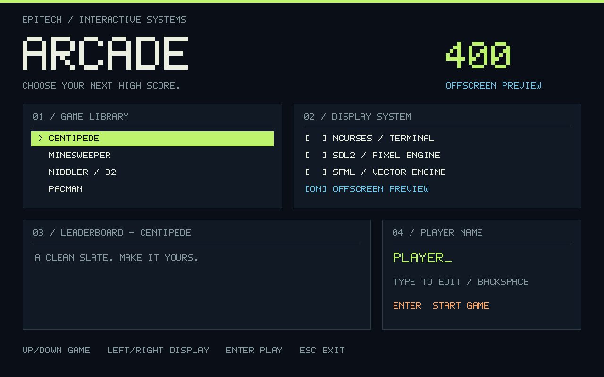
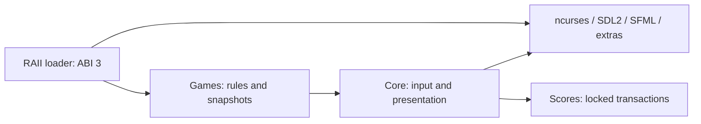

# Arcade

A remake and enhanced version of the original project I completed during my **second year at Epitech**. This version reworks the implementation and adds features beyond the original scope.

**Goal:** build a modular gaming platform in C++, with games and graphics libraries loaded as shared libraries. A running game must survive a graphics backend switch, keeping game logic independent from rendering.

This implementation includes **7 games**, **13 graphics backends** depending on installed dependencies, hot switching, and persistent leaderboards.



## What the platform does

| Area | Details |
|---|---|
| Shared launcher | Choose a game, graphics backend, and player name from one menu |
| Dynamic modules | Discover and load game/display `.so` files through a common plugin contract |
| Live switching | Replace the display during play while keeping the game state and score |
| Session management | Restart, pause, return to the menu, and save the top ten scores per game |
| Extensions | Extra game modes, custom Minesweeper boards, historical Nibbler data, and legacy plugin adapters |

The required foundation is **Snake, Minesweeper, and three graphics libraries**: ncurses, SDL2, and SFML. Bonus modules extend the same interfaces, so each game can run with any available backend.

## Download a binary

[Latest release](https://github.com/lelouchzr/arcade/releases/latest): Linux x86-64 and macOS Apple Silicon archives, with all seven games and the three standard backends.

Extract the archive and run `./play ncurses`. For SDL2/SFML, install the matching graphics runtimes listed in its README. [Release details](doc/RELEASING.md).

## Build from source

Dependencies: C++20, CMake ≥ 3.20, Make, pkg-config, ncurses, SDL2, SFML 2.5/3, and Python 3 for tests.

<details>
<summary>Install dependencies</summary>

```sh
# macOS
brew install cmake pkg-config ncurses sdl2-compat sfml
# Debian / Ubuntu
sudo apt-get install build-essential cmake pkg-config libncurses-dev libsdl2-dev libsfml-dev python3
```

</details>

```sh
make
./arcade ./lib/arcade_sdl2.so
make test
```

Run from the repository root. Alternatives: `arcade_sfml.so` or `arcade_ncurses.so` (terminal ≥ 90×30). [Install the ten additional backends](doc/GRAPHICS.md).

## Games and controls

| Game | Gameplay | Controls |
|---|---|---|
| Snake | Eat, grow, and avoid collisions; optional pickups and speed boosts | Arrows; Space: bonus boost |
| Minesweeper | Reveal safe cells and flag mines; presets and a custom board editor | Arrows; Space/Enter: reveal; F: flag; ?: marks |
| Nibbler | Navigate mazes and clear their fruit; generated and historical campaigns | Arrows; Space: bonus boost |
| Pacman | Clear pellets while avoiding ghosts; Pacmania mode adds jumps and an isometric camera | Arrows; Z/Space: bonus jump; V: camera |
| Qix | Draw trails to capture territory while avoiding the Qix and Sparks | Arrows; F: stop |
| Centipede | Shoot and split descending bodies; bonus mode adds body types and a second player | Arrows/Space; player two: IJKL/H |
| Solar Fox | Shoot collectibles, intercept enemy fire, and navigate the arena | Arrows; Space: shoot; F: boost |

Games start in classic mode. **D/F7** selects their bonuses or difficulty; the HUD shows the active controls. The [bonus guide](doc/BONUSES.md) describes each mode and its rules.

If a backend cannot open (for example, Xlib without an X11 display), Arcade restores the current backend and shows a warning. That backend is marked `[--]` and skipped until the next launch; the current game and score are preserved.

| Navigation | Action |
|---|---|
| Menu | Up/Down: game; Left/Right: backend; type: player name; Enter: play |
| F2 / Tab | Next backend, keeping the current game |
| F3 · F4/R · F5/M · F6/P | Next game · restart · menu · pause |
| D / F7 | Bonus mode or difficulty; cycle Nibbler campaigns |
| Escape | Quit |

## Structure

Games receive abstract actions and return snapshots of their board. The core handles navigation, timing, and presentation; backends only translate input and draw the result.



Plugins use **ABI 3** and RAII ownership: an instance is destroyed before its library is unloaded. Score writes use locks and atomic replacement so multiple running instances can share a leaderboard.

Types live in `include/arcade/`, implementations in `src/`, and extensions in `bonus/`. Strict compilation with `-Werror`. Errors: stderr and **84**; success: **0**.

## Documentation

| Topic | Guide |
|---|---|
| Game modes and bonuses | [Bonuses](doc/BONUSES.md) |
| Backend installation | [Graphics libraries](doc/GRAPHICS.md) |
| Architecture and new modules | [Architecture](doc/ARCHITECTURE.md) · [SDK](doc/PLUGINS.md) |
| Subject coverage and tests | [Requirements](doc/REQUIREMENTS.md) · [Validation](doc/VALIDATION.md) |
| CPU and memory measurements | [Profiling](doc/performance.md) · [Valgrind/libpanel](doc/VALIDATION.md) |
| Legacy plugins | [Compatibility](bonus/legacy/README.md) |

## License

[MIT](LICENSE) for the remake's original code. [Third-party notices](THIRD_PARTY_NOTICES.md) cover dependencies and reference material.
