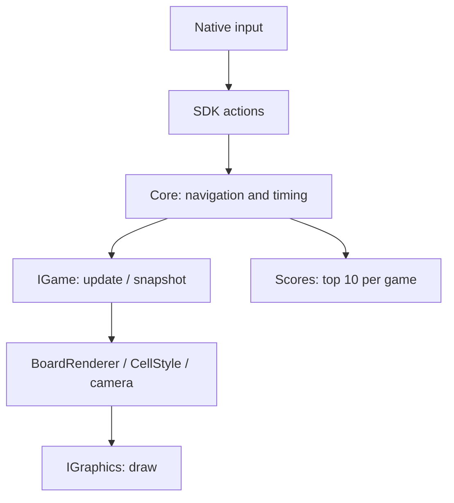

# Arcade architecture

Games produce abstract state; the core composes it; graphics backends translate drawing commands into library calls.

| Area | Classes / files | Responsibility |
|---|---|---|
| Contracts | `include/arcade/Api.hpp` | Plugins, actions, cells, snapshots, backend-independent canvas |
| Core | `Core.cpp` | Construction, discovery, ownership, main clock |
| Input | `CoreInput.cpp` | Menu, global actions, shortcuts |
| Presentation | `CorePresentation.cpp`, `CellStyle.cpp` | Panels, layout, cell appearance |
| Board and camera | `BoardRenderer`, `BoardViewport` | Bounded viewport, isometric projection, overlays, jumps |
| Loading | `SharedLibrary.cpp`, `Plugin.cpp` | libdl wrapper, destruction before unloading |
| Storage | `Scores.cpp`, `ScoreFile.cpp`, `FileLock.cpp` | Interprocess transactions and persistence |
| Backends | One directory per library | Separate lifecycle, input, and rendering files |
| Games | One directory per game | Rules/model, AI/combat/capture, snapshots |
| Legacy | `bonus/legacy/` | Isolated adapters for the original contracts |

## Invariants

| Area | Guarantee |
|---|---|
| Plugins | Instance destroyed before `SharedLibrary::dlclose`; ABI 3 checked before creation |
| Discovery | Stable order, canonical paths, unique IDs, no windows opened |
| Backend switching | Game retained; failed backends marked unavailable and skipped for the session after restoring the previous backend; startup/rollback failures still exit 84 |
| Timing | `steady_clock`, delta capped at 0.25 s; pause stops model advancement |
| Rendering | Semantic cells, bounded camera, elevated sprites; no game rules in backends |
| Scores | Stable sidecar lock, reload under lock, temporary write + fsync + atomic rename |
| Results | Saved once per session; difficulty changes reset the generation |
| Build | Tests use their own build; staging updates the root and removes obsolete modules |

Types belong in `.hpp`, methods in `.cpp`, small templates in headers. Standalone headers and formatting are checked. Legacy archives are isolated.

The SDK uses a local C++ ABI: matching architecture and compatible toolchain required. [Plugin contract](PLUGINS.md) · [Legacy adapters](../bonus/legacy/README.md).
